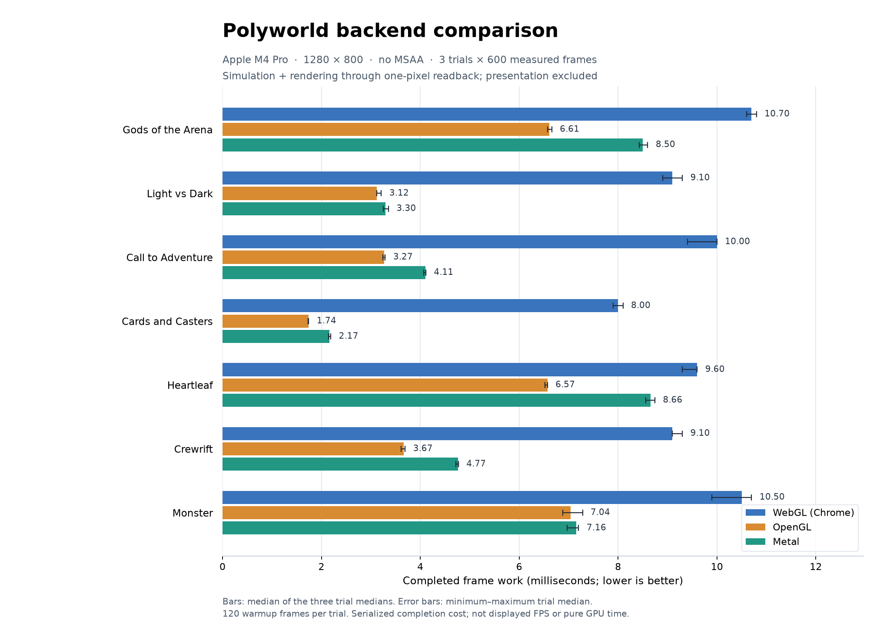

# Polyworld backend benchmark

> GotA correction: the OpenGL ambient-occlusion calls in this snapshot targeted the hidden window rather than the offscreen scene. GotA comparisons against OpenGL therefore did not render matching effects. The Metal-before/after comparison remains valid. See [the corrected GotA investigation](../../gota-metal-performance.md).

Measured on MacBook Pro with Apple M4 Pro, 14 CPU cores, 20 GPU cores, 24 GiB RAM, and macOS 27.2.1.

Commit reference: `e65a5dee083679a10321d82e79a3fc08a70f1f7c`. The repository source fingerprint is `67137a33b015a57d7074e3dcb5c2c6526af346016d042808b4a8c9d0626ce1e7`. The benchmark hooks and runner were committed before measurement.

Measured on AC power with no reported thermal warning. Background applications remained open; these are working-desktop measurements. Chrome 158.0.8127.37 used hardware ANGLE Metal.

OpenGL had the lowest median in every scene. Its advantage over Metal was clear in six games; Monster's trial ranges overlap. Browser gameplay cadence was about 60 FPS, except GotA at 57.4 FPS. These cadence figures include the benchmark readback barrier.

## Method

Each game used seed 42, 1280×800 physical pixels, no MSAA, and a fixed 1/60-second simulation step. Each of the three trials discarded 120 warmup frames and measured the next 600. Cases ran one at a time, with backend order rotated and game order shuffled between trials.

The primary metric is CPU simulation and rendering through a synchronous one-pixel readback from the completed color target. It includes the readback/completion overhead and excludes startup, event-loop pacing, presentation, and display refresh waits. The completion-wait portion is not a GPU timestamp measurement. These results measure serialized whole-game frame work, not pure API overhead, pipelined throughput, or displayed FPS.

WebGL runs in Chrome with WebAssembly and hardware ANGLE/Metal. Native runs use ARM64 release binaries. Native BASIC bots can use JIT compilation; browser bots use the browser-compatible runtime. Therefore differences include runtime and browser costs as well as renderer implementation.

Validation passed for all 63 cases and 37,800 measured frames. Game/backend identity, sample counts, dimensions, frame indices, and every measured simulation tick (turn number for CaC) match across backends and trials. Tick equality verifies progression, not complete world-state or pixel identity.

## Completed frame work

Values are the median of three per-trial medians, in milliseconds. Lower is better.

| Game | WebGL | OpenGL | Metal |
| --- | ---: | ---: | ---: |
| Gods of the Arena | 10.700 | 6.607 | 8.502 |
| Light vs Dark | 9.100 | 3.123 | 3.298 |
| Call to Adventure | 10.000 | 3.273 | 4.108 |
| Cards and Casters | 8.000 | 1.744 | 2.166 |
| Heartleaf | 9.600 | 6.571 | 8.659 |
| Crewrift | 9.100 | 3.665 | 4.767 |
| Monster | 10.500 | 7.044 | 7.158 |

## Tail latency and repeatability

P95 is the median of the three trial p95 values. The range spans the three trial medians; it is not a confidence interval.

| Game | Backend | Median ms | P95 ms | Trial-median range ms |
| --- | --- | ---: | ---: | ---: |
| Gods of the Arena | WebGL (Chrome) | 10.700 | 13.600 | 10.600–10.800 |
| Gods of the Arena | OpenGL | 6.607 | 8.161 | 6.572–6.660 |
| Gods of the Arena | Metal | 8.502 | 10.396 | 8.427–8.600 |
| Light vs Dark | WebGL (Chrome) | 9.100 | 11.600 | 8.900–9.300 |
| Light vs Dark | OpenGL | 3.123 | 3.583 | 3.119–3.212 |
| Light vs Dark | Metal | 3.298 | 3.695 | 3.254–3.357 |
| Call to Adventure | WebGL (Chrome) | 10.000 | 12.700 | 9.400–10.000 |
| Call to Adventure | OpenGL | 3.273 | 4.632 | 3.248–3.291 |
| Call to Adventure | Metal | 4.108 | 5.021 | 4.066–4.113 |
| Cards and Casters | WebGL (Chrome) | 8.000 | 10.900 | 7.900–8.100 |
| Cards and Casters | OpenGL | 1.744 | 1.879 | 1.732–1.744 |
| Cards and Casters | Metal | 2.166 | 2.359 | 2.143–2.190 |
| Heartleaf | WebGL (Chrome) | 9.600 | 11.100 | 9.300–9.600 |
| Heartleaf | OpenGL | 6.571 | 7.029 | 6.523–6.572 |
| Heartleaf | Metal | 8.659 | 9.076 | 8.564–8.745 |
| Crewrift | WebGL (Chrome) | 9.100 | 11.400 | 9.100–9.300 |
| Crewrift | OpenGL | 3.665 | 3.966 | 3.609–3.694 |
| Crewrift | Metal | 4.767 | 5.186 | 4.718–4.771 |
| Monster | WebGL (Chrome) | 10.500 | 12.700 | 9.900–10.700 |
| Monster | OpenGL | 7.044 | 7.421 | 6.880–7.282 |
| Monster | Metal | 7.158 | 7.530 | 6.969–7.203 |

## Relative completed-work costs

Each ratio divides the numerator's frame-work milliseconds by the denominator's. A ratio above 1 means the denominator has lower completed-work cost for that scene.

| Game | OpenGL / Metal | WebGL / Metal | WebGL / OpenGL |
| --- | ---: | ---: | ---: |
| Gods of the Arena | 0.78× | 1.26× | 1.62× |
| Light vs Dark | 0.95× | 2.76× | 2.91× |
| Call to Adventure | 0.80× | 2.43× | 3.06× |
| Cards and Casters | 0.81× | 3.69× | 4.59× |
| Heartleaf | 0.76× | 1.11× | 1.46× |
| Crewrift | 0.77× | 1.91× | 2.48× |
| Monster | 0.98× | 1.47× | 1.49× |
| Equal-game geometric mean | 0.83× | 1.92× | 2.32× |

## Browser cadence

These are actual measured gameplay frame-start intervals, including browser scheduling. Cadence FPS is the reciprocal of each trial's mean interval, summarized across trials; it is separate from the work-time bars above.

| Game | Mean interval ms | Observed cadence FPS |
| --- | ---: | ---: |
| Gods of the Arena | 17.417 | 57.4 |
| Light vs Dark | 16.666 | 60.0 |
| Call to Adventure | 16.666 | 60.0 |
| Cards and Casters | 16.723 | 59.8 |
| Heartleaf | 16.668 | 60.0 |
| Crewrift | 16.691 | 59.9 |
| Monster | 16.720 | 59.8 |

## Loading, reported separately

Initialization-to-gameplay starts when the Nim benchmark module initializes. Browser navigation also includes document loading, downloads, and runtime setup. These are different start points; they are not included in the rendering comparison.

| Game | Native OpenGL init ms | Native Metal init ms | Browser Nim init ms | Browser navigation ms |
| --- | ---: | ---: | ---: | ---: |
| Gods of the Arena | 4023 | 3957 | 6543 | 6605 |
| Light vs Dark | 2843 | 2671 | 4870 | 4943 |
| Call to Adventure | 1663 | 1562 | 2960 | 3010 |
| Cards and Casters | 5279 | 5204 | 9487 | 9596 |
| Heartleaf | 1864 | 1805 | 3386 | 3455 |
| Crewrift | 2468 | 3504 | 8389 | 8446 |
| Monster | 1350 | 1231 | 2324 | 2401 |

## Artifacts

- [Numerical summary CSV](comparison.csv)
- [All measured frames, compressed JSON](frames.json.gz)
- [Validation and tick-parity checks](validation.json)
- [Hardware and toolchain details](hardware.json)
- [Reproduction and measurement details](../../backend-benchmarks.md)

This snapshot predates concurrent backend commit `2a23b779`. It measures commit `e65a5dee`, as recorded above.
