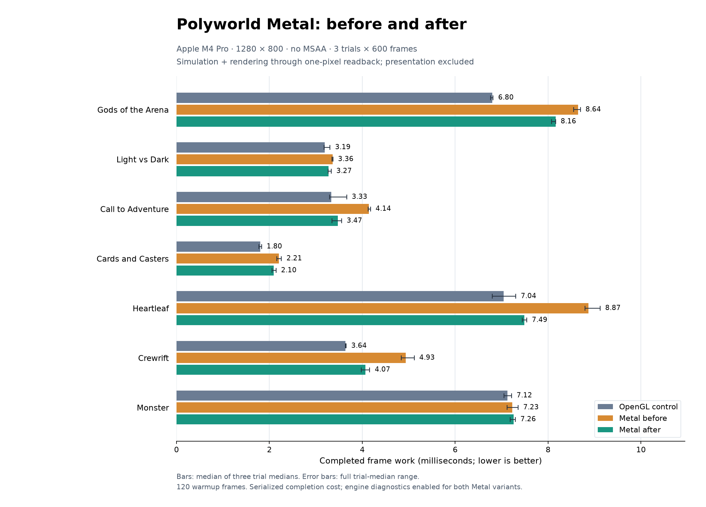

# Polyworld Metal performance comparison

> GotA correction: the OpenGL ambient-occlusion calls in this snapshot targeted the hidden window rather than the offscreen scene. GotA comparisons against OpenGL therefore did not render matching effects. The Metal-before/after comparison remains valid. See [the corrected GotA investigation](../../gota-metal-performance.md).

Measured November 25, 2026 on an Apple M4 Pro MacBook Pro with 14 CPU cores,
20 GPU cores, 24 GiB RAM, and macOS 27.2.1. The machine used AC power with
background applications open. Hardware and toolchain details are in
[hardware.json](provenance/hardware.json).

The Metal implementation had avoidable allocation and render-pass overhead.
The fixes reduced completed frame work by 15.6% in Heartleaf, 17.5% in
Crewrift, and 16.2% in CTA, with smaller improvements in three other games.
Monster's -0.5% change is within the overlapping trial ranges. Native OpenGL
still has lower medians in these scenes. This result does not establish an
inherent speed ordering between graphics APIs.

## Findings and fixes

- Large uniform blocks previously allocated a new native Metal buffer for
  each draw. Toon palettes contain 128 matrices, approximately 8 KiB per
  draw. A reusable upload arena now gives each draw a distinct 256-byte
  aligned slice and recycles storage only after GPU completion. It retains
  at most 16 MiB between submissions. Median engine buffer allocations per
  frame dropped from 589 to 0 in Heartleaf and 330 to 1 in Crewrift.
  This follows Apple's guidance to reuse buffers and change binding offsets
  for large dynamic data. [Apple buffer bindings guidance](https://developer.apple.com/library/archive/documentation/3DDrawing/Conceptual/MTLBestPracticesGuide/BufferBindings.html)
- Clears, viewport updates, repeated target bindings and clean atlas lookups
  unnecessarily split render passes. Clears now retain their encoder for
  subsequent draws, viewport updates are lazy, identical target bindings
  preserve the pass, and clean atlases avoid a flush. Required transitions
  for target changes, shared depth, UI compositing and MSAA resolves remain.
  CTA's median engine render-pass count dropped from 28 to 18.
- Silky avoids empty external UI passes and atlas work when no preparation
  is pending. Depth-state cache keys now use packed integers rather than
  allocating strings during drawing.
- Metal validation also exposed mipmap generation on single-level textures.
  Both engine and Silky paths now skip that invalid operation.

Heartleaf's median CPU interval fell from 3.812 to 2.631 ms, and Crewrift's
from 2.758 to 1.771 ms. GPU spans changed much less in those games. CTA also
benefited from GPU work reduction: its median GPU span fell from 2.048 to
1.828 ms. Separately aggregated medians must not be added to reconstruct
another metric's median. GPU spans come from completed command-buffer
start/end timestamps, rather than treating CPU wait duration as GPU time.
[Apple GPU timestamp documentation](https://developer.apple.com/documentation/metal/mtlcommandbuffer/gpustarttime)

## Remaining limitation

Normal Metal `endFrame` still calls `waitUntilCompleted` every frame. That
prevents the next frame's CPU preparation from overlapping the current GPU
submission. Removing the wait requires bounded frames in flight plus safe
ownership of upload buffers, mutable textures and Silky atlas data. Simply
removing it would allow CPU writes or resource recycling while the GPU is
still reading. Apple's buffering guidance describes this overlap and the
associated resource-lifetime requirement.
[Apple triple-buffering guidance](https://developer.apple.com/library/archive/documentation/3DDrawing/Conceptual/MTLBestPracticesGuide/TripleBuffering.html)

The benchmark deliberately waits for a one-pixel readback each frame. It
therefore cannot measure the throughput benefit of future frames-in-flight
work. OpenGL can also begin processing commands while the CPU is issuing
later calls, whereas this Metal path primarily submits at the frame end.
After readback, Metal resumes a command buffer that is submitted outside the
primary timed interval. Cumulative counters preserve those submissions.

## Measured revisions and method

Candidate commit: `08bbfb170b9cd4b8110b0525b54a337d5d05c00c`. Source fingerprint: `aab0b89555b34e0e5353626d41d99ed93d67632aeaca3f7fb30642dc2f946e56`.

Instrumented baseline: `5a97de971b36751c6e459d70508e182161038553`. OpenGL control reference: `e65a5dee083679a10321d82e79a3fc08a70f1f7c`.

Silky before: `b56d00abb346d96e475cd30826f1d4f811f6fba4`. Silky after: `f2754a1045a046a9e8366d7522c33cc091814958`.

All 63 trials ran one process at a time, with seeded game order and rotated variant order. Each trial used seed 42, default preferences, matching rosters, 1280×800 physical pixels, no MSAA, a fixed 1/60-second frame delta, 120 warmup frames and 600 measured frames. Native saves were isolated, benchmark autosaves disabled, and GPU validation/debug/HUD environment variables removed.

The primary metric includes CPU simulation, encoding, GPU completion and synchronous one-pixel readback. Startup, presentation and pacing are excluded. It measures serialized completion latency; a normal pipelined renderer can overlap CPU and GPU work. Both Metal variants include the same diagnostic instrumentation; the retained OpenGL control does not have Metal diagnostics.

Validated 63 cases and 37,800 frame samples, with matching per-frame simulation progress across all nine cases per game. CaC records turn numbers. Progress equality does not prove complete world-state or pixel identity.

## Completed frame work

Median of three per-trial medians, milliseconds; lower is better.

| Game | OpenGL control | Metal before | Metal after | Reduction |
| --- | ---: | ---: | ---: | ---: |
| Gods of the Arena | 6.795 | 8.643 | 8.161 | 5.6% |
| Light vs Dark | 3.190 | 3.359 | 3.272 | 2.6% |
| Call to Adventure | 3.333 | 4.142 | 3.472 | 16.2% |
| Cards and Casters | 1.801 | 2.206 | 2.095 | 5.0% |
| Heartleaf | 7.045 | 8.868 | 7.488 | 15.6% |
| Crewrift | 3.640 | 4.933 | 4.069 | 17.5% |
| Monster | 7.122 | 7.226 | 7.260 | -0.5% |



Reduction is `100 × (before − after) / before`; negative values indicate a regression.

## Tail latency and variation

P95 is the median of the three nearest-rank trial p95 values. Trial range is not a confidence interval.

| Game | Variant | Median ms | P95 ms | Trial-median range ms |
| --- | --- | ---: | ---: | ---: |
| Gods of the Arena | OpenGL control | 6.795 | 8.221 | 6.761–6.817 |
| Gods of the Arena | Metal before | 8.643 | 9.769 | 8.550–8.696 |
| Gods of the Arena | Metal after | 8.161 | 9.727 | 8.075–8.162 |
| Light vs Dark | OpenGL control | 3.190 | 3.602 | 3.176–3.305 |
| Light vs Dark | Metal before | 3.359 | 3.851 | 3.351–3.368 |
| Light vs Dark | Metal after | 3.272 | 3.827 | 3.268–3.332 |
| Call to Adventure | OpenGL control | 3.333 | 4.679 | 3.296–3.665 |
| Call to Adventure | Metal before | 4.142 | 5.149 | 4.128–4.177 |
| Call to Adventure | Metal after | 3.472 | 4.781 | 3.348–3.555 |
| Cards and Casters | OpenGL control | 1.801 | 2.121 | 1.772–1.831 |
| Cards and Casters | Metal before | 2.206 | 2.603 | 2.158–2.259 |
| Cards and Casters | Metal after | 2.095 | 2.457 | 2.058–2.142 |
| Heartleaf | OpenGL control | 7.045 | 7.864 | 6.798–7.304 |
| Heartleaf | Metal before | 8.868 | 10.121 | 8.798–9.120 |
| Heartleaf | Metal after | 7.488 | 8.103 | 7.445–7.542 |
| Crewrift | OpenGL control | 3.640 | 3.942 | 3.637–3.653 |
| Crewrift | Metal before | 4.933 | 5.427 | 4.836–5.118 |
| Crewrift | Metal after | 4.069 | 4.394 | 3.982–4.160 |
| Monster | OpenGL control | 7.122 | 7.641 | 7.049–7.213 |
| Monster | Metal before | 7.226 | 7.774 | 7.116–7.356 |
| Monster | Metal after | 7.260 | 7.658 | 7.181–7.295 |

## Metal diagnostics

Each cell below is **mean / median**: respectively the median of three per-trial means and the median of three per-trial medians. GPU values are completed command-buffer execution spans, not CPU waits. All measured buffers must have valid GPU timestamps.

| Game | Variant | CPU ms | GPU ms | Render passes | Passes without draws | Buffer allocations |
| --- | --- | ---: | ---: | ---: | ---: | ---: |
| Gods of the Arena | Metal before | 3.235 / 2.763 | 5.369 / 5.311 | 15.003 / 15.000 | 4.000 / 4.000 | 186.685 / 189.000 |
| Gods of the Arena | Metal after | 2.834 / 2.358 | 5.310 / 5.270 | 10.003 / 10.000 | 0.000 / 0.000 | 10.717 / 10.000 |
| Light vs Dark | Metal before | 0.572 / 0.513 | 2.718 / 2.661 | 6.005 / 6.000 | 3.000 / 3.000 | 12.248 / 11.000 |
| Light vs Dark | Metal after | 0.509 / 0.453 | 2.682 / 2.624 | 3.005 / 3.000 | 1.000 / 1.000 | 1.830 / 2.000 |
| Call to Adventure | Metal before | 1.615 / 1.562 | 2.054 / 2.048 | 27.935 / 28.000 | 8.978 / 9.000 | 21.110 / 21.000 |
| Call to Adventure | Metal after | 1.491 / 1.438 | 1.826 / 1.828 | 17.957 / 18.000 | 0.000 / 0.000 | 1.218 / 1.000 |
| Cards and Casters | Metal before | 0.970 / 0.956 | 1.125 / 1.103 | 18.158 / 18.000 | 3.015 / 3.000 | 68.198 / 68.000 |
| Cards and Casters | Metal after | 0.879 / 0.854 | 1.149 / 1.096 | 17.158 / 17.000 | 2.015 / 2.000 | 2.198 / 2.000 |
| Heartleaf | Metal before | 3.876 / 3.812 | 4.585 / 4.459 | 6.990 / 7.000 | 3.995 / 4.000 | 588.125 / 589.000 |
| Heartleaf | Metal after | 2.659 / 2.631 | 4.376 / 4.341 | 3.995 / 4.000 | 1.000 / 1.000 | 0.000 / 0.000 |
| Crewrift | Metal before | 2.790 / 2.758 | 1.720 / 1.673 | 3.000 / 3.000 | 2.000 / 2.000 | 330.000 / 330.000 |
| Crewrift | Metal after | 1.785 / 1.771 | 1.753 / 1.739 | 2.000 / 2.000 | 1.000 / 1.000 | 1.000 / 1.000 |
| Monster | Metal before | 4.593 / 4.554 | 2.045 / 2.005 | 8.010 / 8.000 | 4.000 / 4.000 | 27.895 / 28.000 |
| Monster | Metal after | 4.758 / 4.746 | 1.963 / 1.884 | 5.010 / 5.000 | 1.000 / 1.000 | 1.020 / 1.000 |

Pass, draw and allocation counters cover engine operations; Silky's internal encoders and allocations are excluded from those counters. GPU spans include all work in the shared command buffer, including Silky. Passes without draws include clear-only passes, which may do useful GPU work.

`bufferBytes` counts newly allocated engine buffer capacity, not all CPU writes into reused storage. `uniformBytes` counts bound uniform data and overlaps large uniform buffer bytes in the baseline. Cumulative command-buffer differences (`allSubmissionsPerInterval`) expose submissions outside the timed interval, including an empty command buffer submitted after readback. The first sample is excluded from that difference.

Full means, medians, p95 values, ranges, upload/capacity counters and per-trial details are retained in the CSV and JSON. Small changes whose trial ranges overlap need further measurement. These seeded scenes cover ten simulation seconds after warmup and do not represent every workload.

## Artifacts

- [Full statistics CSV](comparison.csv)
- [Analysis with every trial](analysis.json)
- [Validation](validation.json)
- [Run manifest and binary hashes](run.json)
- [All 63 raw frame files, compressed JSON](frames.json.gz)

## Correctness checks

All seven games passed release checks and builds for both instrumented Metal
revisions. Ordinary Crewrift OpenGL and Metal configurations passed `nim check` with
benchmark/profile flags disabled. Backend boundary and Shady-source guards
passed. The following ten engine GPU regressions passed with
`MTL_DEBUG_LAYER=1`, separately from timing:

- `tests/test_metal_pass_reuse.nim`
- `tests/test_metal_uploads.nim`
- `tests/test_metal_resource_ordering.nim`
- `tests/test_metal_core.nim`
- `tests/test_metal_viewers.nim`
- `tests/test_metal_waters.nim`
- `tests/test_metal_shadows_render.nim`
- `tests/test_metal_characters.nim`
- `tests/test_effects_metal.nim`
- `games/cac/tests/test_post_render_metal.nim`

Silky's `tests/test_metal_compositing.nim` also passed with Metal validation,
including atlas mipmaps and empty external UI frames. New engine tests check
pixels at 1x and 4x MSAA, viewport restoration, target transitions, depth and
stencil behavior, upload alignment and immutable slices, repeated reuse,
retention limits and cleanup. All shader sources remain Shady-authored.

An independent recalculation found no discrepancy in any reported CSV
statistic. All 25,200 Metal frame samples have matching before/after draw
counts, bound uniform bytes and simulation ticks. Every measured command
buffer has valid GPU timestamps. Source, dependency, runner and binary
fingerprints remained unchanged during the 63 trials. Matching counters do
not prove complete scene or pixel equality; the GPU regressions check the
specific rendering behaviors affected by these changes.

## Reproduction and archived data

The general workload, launch arguments and timing definitions are documented
in [backend-benchmarks.md](../../backend-benchmarks.md). Build each Metal
revision in its own checkout, with the Silky revision listed above:

```sh
python3 tools/bench_backends.py build --backends metal --define metalProfile --jobs 3
```

The exact experiment runner is archived as [compare.py](provenance/compare.py).
Its SHA-256 matches the run manifest. It records the original worktree paths;
to repeat the run, place it at `tmp/metal-perf/compare.py` in the candidate
checkout and adjust `CONTROL_ROOT` to the OpenGL checkout. Preserve the
baseline binaries and manifest at `tmp/metal-perf/baseline`, and build the
candidate with `--out tmp/metal-perf/build`. Finish all compilation and GPU
validation before running the comparison:

```sh
python3 tmp/metal-perf/compare.py run --run-dir tmp/metal-perf/runs/new
python3 tmp/metal-perf/compare.py report --run-dir tmp/metal-perf/runs/new
```

Report generation requires matplotlib, or `--no-plot`. Run directories must
be new. The runner balances variant order and verifies source and executable
fingerprints before and after measurement. Its OpenGL reference and baseline
Silky constants describe this specific experiment and must be updated when
comparing other revisions.

`frames.json.gz` is a JSON object mapping each original raw filename to its
complete payload. `run.json`, build manifests and `analysis.json` retain
original local paths for provenance. To replay analysis elsewhere, decompress
the payloads into a new raw directory and update each `run.json` case's `raw`
path to that directory. The CSV contains enough precision to recompute the
published percentages. The archived plot and report summarize the fixed
measured candidate, which predates the concurrent DirectX/Vulkan work.
