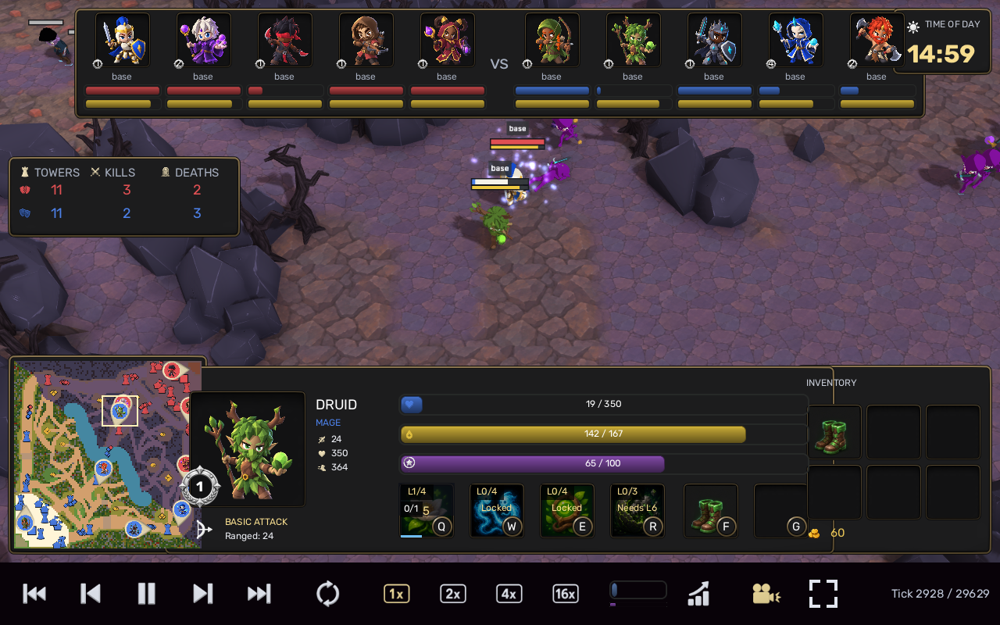

# GotA Metal submission and throughput

The Metal renderer now submits a gameplay frame without waiting for its GPU
completion. Three bounded submission slots let the CPU prepare later frames
while the GPU executes earlier work. Normal rendering, screenshots, UI
compositing and explicit readback use the same renderer.

## Rendering changes

- One shared command buffer contains the scene, ordered texture uploads and
  Silky UI. Render-pass dependencies stay on the GPU.
- Each submission owns its immutable uniform and texture-upload slices.
  Storage is recycled only after completion. Each slot retains at most
  16 MiB of upload capacity after reclamation.
- A full queue waits for the oldest submission. Readback and shutdown drain
  outstanding work explicitly. Command-buffer failures are reported when
  completed work is reclaimed.
- Mutable engine textures, array layers and Silky atlas/image updates use
  ordered staging copies. CPU source images can be reused immediately.
- Upload-only command buffers are distinguished from active scene frames,
  including character initialization.
- Metal filtering now explicitly matches OpenGL for post-processing,
  shadow comparisons, water, Toon ramps, world text, FX patterns and terrain
  data maps. Generated terrain and splat arrays retain 8x anisotropy.
  Material/IBL sampling policies are unchanged.

This follows Apple's guidance to keep the CPU ahead of the GPU with bounded
dynamic resources and few command-buffer submissions. It does not require
putting every draw into one render pass. [Apple command-buffer guidance](https://developer.apple.com/library/archive/documentation/3DDrawing/Conceptual/MTLBestPracticesGuide/CommandBuffers.html),
[Apple buffering guidance](https://developer.apple.com/library/archive/documentation/3DDrawing/Conceptual/MTLBestPracticesGuide/TripleBuffering.html).

## Validation

Fourteen engine GPU regressions passed again after the filtering correction,
with Metal API validation enabled. Coverage includes 1x/4x MSAA, render-pass
reuse, characters and skinning, water/reflections, AO, shadows, selection,
terrain, effects, partial texture updates and CaC composition.

The new queued-frame test also passed in asynchronous and synchronous modes:
it checks every output pixel across twelve submissions, changing uniforms,
vertices and textures, partial array updates, source-image poisoning,
resizing, queue bounds and shutdown with outstanding work. Silky's test
encodes three changing atlas/image frames before submitting any of them.
The OpenGL regression verifies actual MSAA storage, color resolve, AO depth
copies and bounded fence accounting. Profiling-epoch tests cover delayed
completion across interval resets.

Normal GotA OpenGL and Metal checks, builds and 120-frame gameplay captures
passed. The Metal capture uses 4x MSAA and API validation. The matching
OpenGL capture uses its standard single-sample screenshot target. The
scene, characters, effects, AO and UI were visually compared.



## Corrected comparison

GotA's OpenGL ambient-occlusion calls previously omitted the source target.
They read and composited into framebuffer zero even when the benchmark was
rendering offscreen. Metal used the active scene target. Both calls now
receive the actual screenshot/benchmark framebuffer, following the existing
CTA integration. The earlier GotA OpenGL-versus-Metal results did not measure
matching effects and should not be used to rank the backends.

The old per-frame one-pixel readback benchmark remains available for
serialized completion latency. A new native throughput mode drains warmup,
times the entire measurement window, submits every requested frame, and
includes final GPU completion. OpenGL fences and Metal completion markers
limit both asynchronous variants to three outstanding logical frames.

The three treatments use the same source and scene: OpenGL, Metal with
`-d:metalSynchronous`, and asynchronous Metal. The synchronous control uses
one outstanding frame and waits after each submission. Both Metal treatments
include identical profiling. The runner checks completed frame counts,
queue bounds, dimensions, samples, every simulation tick, source/dependency
fingerprints and executable hashes.

`throughputFps` is completed frames divided by total elapsed time. Per-frame
`workMs` stops at submission and is not completed-frame latency. `cpuMs`
includes frame-begin queue backpressure; `submitMs` includes synchronous
completion waits in the control. Metal GPU timestamps are summed execution
spans, which may overlap across submissions and must not be interpreted as
GPU utilization. Presentation, display pacing and vsync are excluded.

## Measurement status

A short pilot showed a promising asynchronous improvement, but the longer
run encountered concurrent graphics tests, simulator activity and compilation
on the shared Mac. The observed load average reached 179. The run was stopped
during its ninth case, retaining all eight completed cases and 14,400 frames.

| Treatment | Completed 1x trials, frames/s |
| --- | --- |
| OpenGL | 51.3, 59.3, 75.6 |
| Synchronous Metal | 33.4, 25.8 |
| Asynchronous Metal | 60.2, 68.4, 60.0 |

These overlapping ranges do not establish a reliable winner. They were
measured at `d142fd4f`, before the sampler-parity correction, and are not a
performance result for the final filtering settings. The 4x timing matrix
was not started. [Interrupted run manifest](benchmarks/2026-11-25-gota-throughput/interrupted-run.json)
and [complete payloads for the finished cases](benchmarks/2026-11-25-gota-throughput/interrupted-frames.json.gz)
preserve the evidence without declaring the run successful.

## Reproduction

Use a quiet machine with no other graphics tests or compilation. Finish all
builds and validation before timing, keep rendering quality fixed, and retain
every trial and its variation. Do not choose trials based on their speed.

```sh
python3 tools/bench_gota_throughput.py build --samples 1
python3 tools/bench_gota_throughput.py build --samples 4
python3 tools/bench_gota_throughput.py run --samples 1 --warmup 600 --frames 1800 --trials 3 --run-dir tmp/gota-throughput/quiet-1x
python3 tools/bench_gota_throughput.py run --samples 4 --warmup 600 --frames 1800 --trials 3 --run-dir tmp/gota-throughput/quiet-4x
```

Each process uses seed 42, ten BASIC bots, default preferences, 1280x800
physical pixels and a fixed 1/60-second frame delta. GotA advances 120
simulation seconds before the warmup frames. The 4x case matches the game's
normal antialiasing setting. These are uncapped offscreen throughput tests;
normal displayed FPS still depends on game pacing and display refresh.
